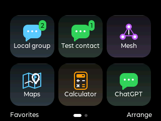
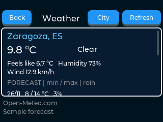
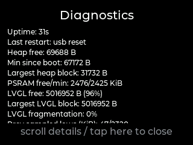

# MeshDeck

MeshDeck is an independent [T-UI](https://github.com/jeeab/t-ui-firmware) fork for using [Meshtastic](https://meshtastic.org/) from a handheld LoRa device. The **LILYGO T-Deck Plus** is the reference hardware. The project aims to bring the same core interface to other devices with a touchscreen, a physical keyboard, or both.

## Screenshots

| Home | Weather | Diagnostics |
| --- | --- | --- |
|  |  |  |

Home and Weather show the firmware interface rendered at T-Deck Plus resolution with sample data. Diagnostics was captured on a T-Deck Plus.

## Features

- **Customizable home screen** with pinned conversations, unread counts, and apps you can move between pages.
- **Offline maps** with tiles stored on microSD, a HearHam repeater directory, and a calculator.
- **Weather** with city search, five-day forecasts, and cached results.
- **Settings and diagnostics** with notification tones, volume control, keyboard lock, and memory statistics.
- **English, Italian, and Spanish** for the home screen, favorites, app arrangement, main settings, and weather. Other screens are still being translated.

## T-Deck Plus beta

The beta candidate uses MeshDeck UI **2026.11.26.6** on the **LILYGO T-Deck Plus with LoRa, ESP32-S3 and 16 MB of flash**. First installation from both the LILYGO factory firmware and official Meshtastic was tested in Chrome on one device. The tests covered restoring a full backup, preserving touchscreen calibration across a restart and exchanging LoRa node information. Direct-message delivery on a clean installation still needs confirmation.

The [web installer preview](https://meshdeck.preparacionrealista.es/) shows the installation flow. Firmware installation is disabled on the public preview. A first installation erases internal flash, so back up your configuration, channels and keys before testing. At the first PIN screen, **press Alt+C to calibrate the touchscreen**, then enter the default PIN **1234** after the keypad returns.

## Roadmap

| Stage | Work |
| --- | --- |
| **T-Deck Plus beta** | Repeat installation and recovery on a second unit, confirm direct-message delivery on a clean device, and complete the beta installation and troubleshooting guide. |
| **Shared input and setup** | Make first boot, calibration, PIN entry, Home and Settings usable with touchscreen or physical controls. Reuse the same screen logic across devices. |
| **First additional models** | Evaluate **RAK WisMesh TAP V2** for touch-only use and **LILYGO T-LoRa Pager** for keyboard and rotary navigation. Validate installation, recovery and messaging on each device. |
| **Further hardware** | Evaluate **Seeed Wio Tracker L2 Pro**, **Elecrow ThinkNode M9** and the original **T-Deck**. Explore **T-Deck Pro** as a separate e-paper adaptation. |

A model is listed as supported after installation, recovery, core controls and messaging have been verified on physical hardware. If you can help test a model or provide a development unit, open a [GitHub issue](https://github.com/Aleph72/MeshDeck/issues) with the exact model and hardware revision.

## Building and contributing

The build uses Python 3.10+ and PlatformIO with the `t-deck-tft` target. See the [technical documentation](README.field.md) for build steps, dependencies, and tests.

Bug reports and contributions are welcome. When reporting an issue, include your device model, MeshDeck version, and steps to reproduce it.

## License and credits

MeshDeck is an independent project based on T-UI and Meshtastic. The [original T-UI README](README.upstream.md) preserves the upstream credits. MeshDeck is distributed under the [GPL-3.0 license](LICENSE).
